# THE KING OF FIGHTERS 2002 ULTIMATE

[Español](README.md) | **English**

A romhack of **The King of Fighters 2002 Plus** (Neo Geo). It adds **new characters taken from other fighting games** (KOF 2001, 2003, XI, SVC Chaos and KOF 2002 UM) without removing any of the 41 originals, a **practice mode with on-screen data** and, later on, a new mechanics system called **DRIVE / DRIVE EX**. It is designed to be played **online through Fightcade**.

> **This repository only contains the project description, its roadmap and progress images.**
> There are no ROMs, BIOS, code, tools or emulators here. To play you will need to own the original games legally; the distribution format is still to be decided (§9).

*Status as of November 7, 2026.*

---

## Current roster: new characters

| 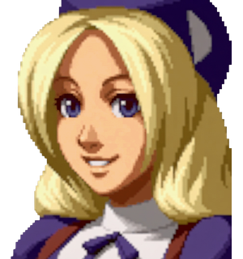 | 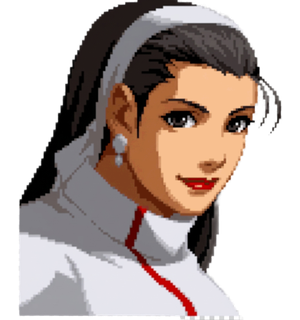 | 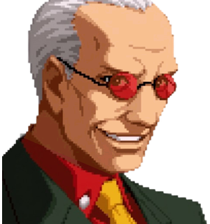 | 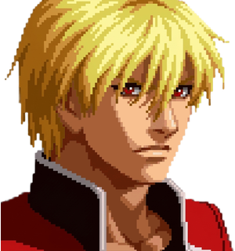 |
|:---:|:---:|:---:|:---:|
| **Hinako Shijou** | **Chizuru Kagura** | **Oswald** | **Rock Howard** |
| KOF 2002 UM | KOF 2003 | KOF XI | KOF 2003 |
| Start on Athena | Start on Mai | Start on Blue Mary | Start on Joe |

Also: **Orochi Iori** (SVC Chaos), who appears through Iori's *Awakening* mid-fight, and **Violent Ken** (SVC Chaos), coming soon. They join the 41 original KOF 2002 characters, who are all still there.

---

## 1. Summary

| Question | Answer |
|---|---|
| What is it? | A romhack of KOF 2002 Plus (`kf2k2pls`) on our own **expanded cartridge** (`kf2k2hnk`), with more room for program, graphics and sound |
| Main goal | Complete **new characters** (normals, throws, specials, supers, voices and portraits) without replacing anyone |
| Secondary goal | **DRIVE mechanics** (Drive Rush, Drive Counter, Drive EX) with their own **editor** |
| Where it is played | FBNeo and **Fightcade** (online), with its own driver. Everything lives inside the cartridge: no scripts or emulator tricks |
| What it is NOT | It is not a new engine: it is the KOF 2002 engine with added data and routines |

---|---|---|---|
| **Hinako Shijou** | KOF 2002 UM / 2003 / 2001 | Start on **Athena** | Complete, in final testing |
| **Orochi Iori** | SVC Chaos | Iori's **Awakening** during the fight | Very advanced: everything done, being polished |
| **Oswald** | KOF XI | Start on **Blue Mary** | Complete, under review |
| **Chizuru Kagura** | KOF 2003 | Start on **Mai** | Complete (phases 1-5), under review |
| **Rock Howard** | KOF 2003 | Start on **Joe** | Phases 1-5 done, under review |
| **Violent Ken** | SVC Chaos | Start on **Ryo** | Started (phase 1: measured and planned) |

---

## 2. Glossary

| Term | Meaning |
|---|---|
| **KOF 2002 Plus** (`kf2k2pls`) | The Neo Geo version of KOF 2002 used as the base |
| **Expanded cartridge** (`kf2k2hnk`) | Our romset: 9 MB program, 128 MB graphics, 512 KB Z80 sound and 32 MB voices, with its own driver in FBNeo / Fightcade |
| **Identity** | Internal graphics number of each new character. It uses the logic of an original character (the "donor") and adds its own on top |
| **Timeline (T)** | The animation of an action: steps with drawing, duration, boxes, sounds and effects |
| **Boxes** | Hurtbox (where you get hit) and hitbox (where you hit), per frame |
| **DM / SUPER MAX / HIDDEN** | Regular super, its MAX mode version and the hidden super |
| **DRIVE / Drive EX** | New resource (3 stocks per round) and an enhanced version of a special that spends 1 stock |

---

## 3. How it is built

- **Reverse engineering of the engine.** The 68000 program has been documented (characters, animations, boxes, hits, palettes, sounds, menus), always by measuring in MAME.
- **Several games, the same engine.** KOF 2001, 2002, 2003, SVC Chaos and UM share structures, so their data is **translated** to the 2002 format. KOF XI was decrypted separately.
- **Character importer.** It converts a character's data (drawings, animations, boxes, states, sounds) to the cartridge with an **interpreter** written in 68000 assembly. The **damage** is always as in KOF 2002. A **comparator** shows the original frame by frame next to the cartridge.
- **Nothing original is overwritten.** New content lives in free space of the expanded cartridge. Every change is checked with a fingerprint of the 41 originals (it must give 41/41) and, without edits, the cartridge must come out identical (same CRC).
- **Automated tests in MAME.** Scripted fights without a window, RAM reading, sound logging and random matches to look for crashes.
- **Editing tools that need no programming.** Local browser pages for animations, effects, boxes, voices, colors (**PalMod** style), portraits and Drive EX. What you edit goes into the next build (§7).

---

## 4. New characters

### 4.1 Hinako Shijou: hidden, complete

- **How to select:** cursor on **Athena** + **Start**.
- **Gameplay:** based on **KOF 2002 UM**: normals, command normals, chain combos, throws, specials (Tsukidashi, Shiko Toumi, Gorin Tsuki, Harite…) and supers, with a **new HIDDEN, *Daisyarin***.
- **Graphics and sound:** KOF 2003 sprites, KOF 2001 voices, select, life bar and victory portraits.
- **Extras:** MAX supercancel.
- **Status:** all steps done. Her final test and the online test are still pending.

| | |
|---|---|
| 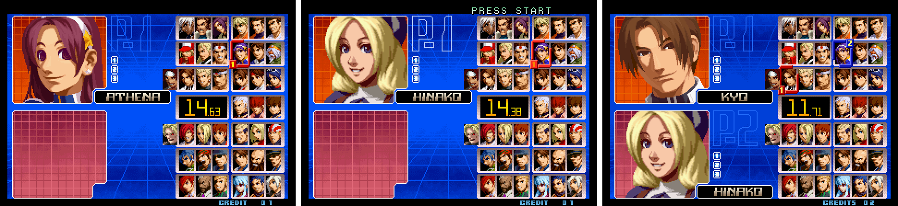 | 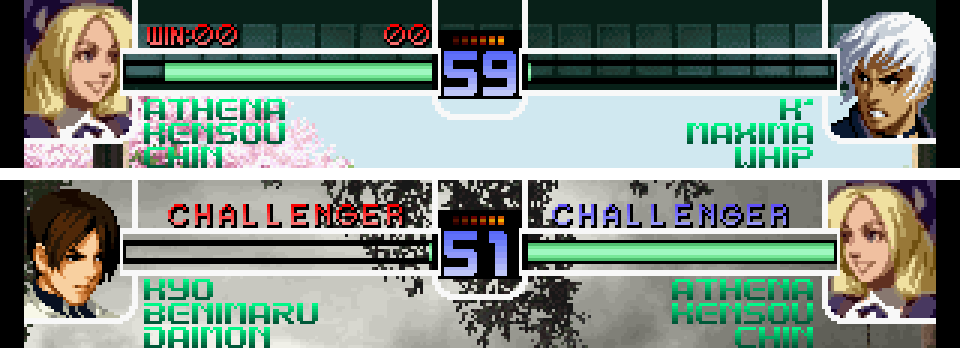 |
| 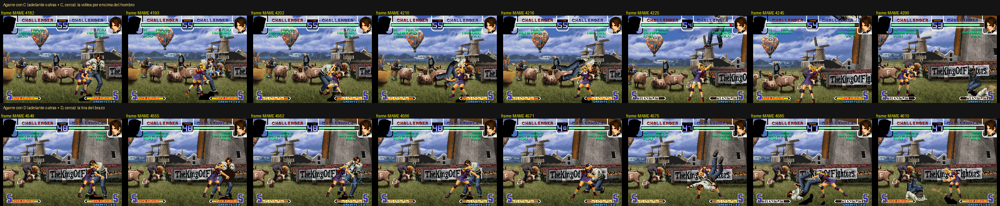 | 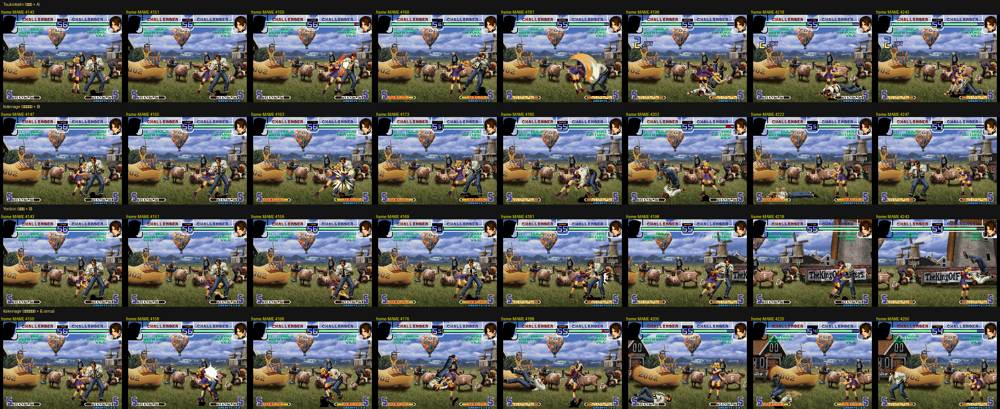 |
| 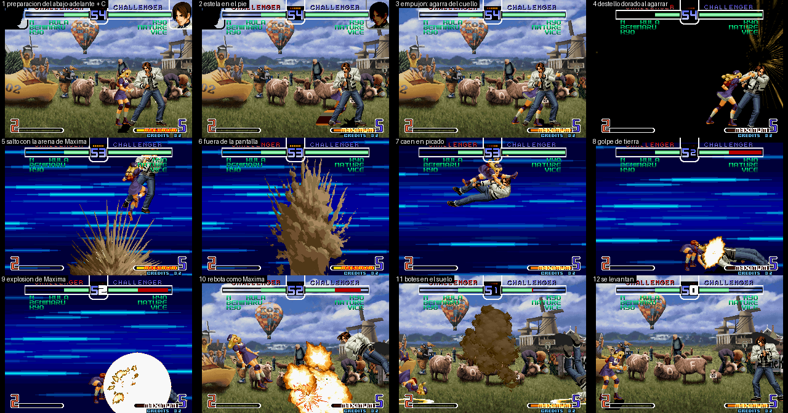 | 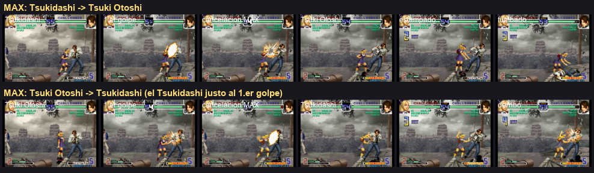 |
| 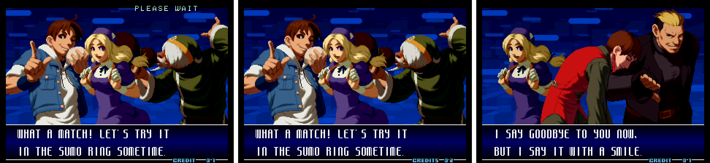 | 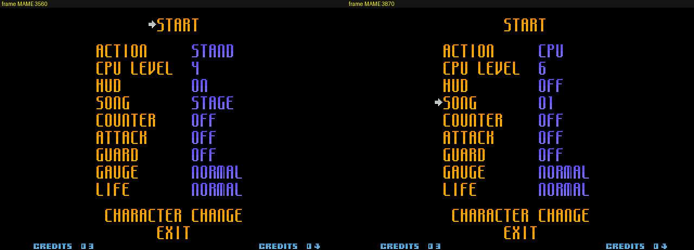 |

### 4.2 Orochi Iori (SVC Chaos): Iori's awakening

- **How he appears:** Iori performs the **Awakening** (like Leona: ↑↓↑↓↑↓ + B+D). It costs half of his life and lasts until the end of the round.
- **Graphics:** the SVC Chaos sprites, with the whole body redrawn frame by frame and the boxes fitted automatically to each drawing.
- **Done:** SVC normals and physics, throws with a different pose for each opponent, specials (Yami Barai, Oniyaki, Aoi Hana, Kototsuki You, Kuzukaze), supers (DM *Kin 1201 Shiki Ya Otome*, SUPER MAX *Oni Honou* and the HIDDEN **EXCEED** with the red background of Iori's Hidden), selectable voices and portraits when he awakens.
- **Status:** being polished and reviewed.

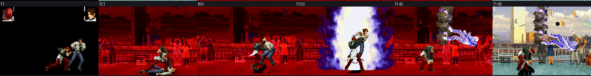

| | |
|---|---|
| 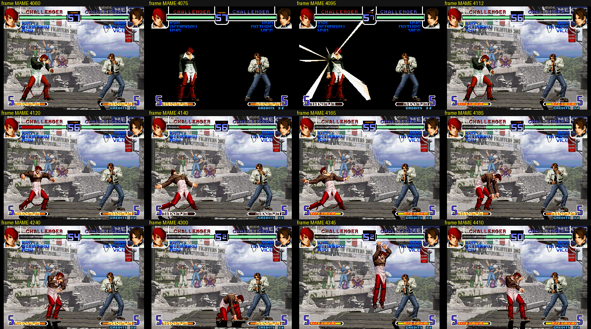 | 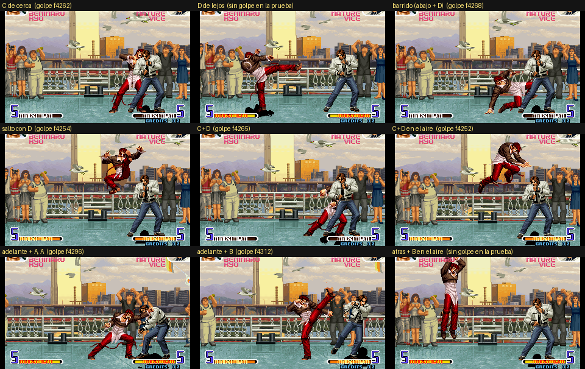 |
| 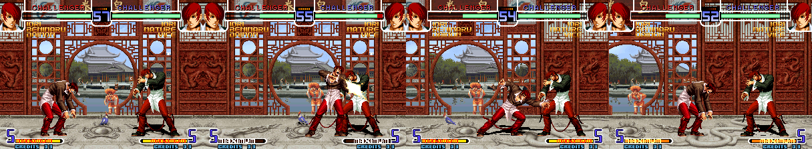 | |

### 4.3 Oswald (KOF XI)

- **How to select:** cursor on **Blue Mary** + **Start**.
- **Graphics and sound:** his 828 KOF XI sprites, identical to the original, and his 59 voices and effects.
- **Gameplay:** his **deck** (Spade, Diamond, Club, Heart, Queen, King…) with the chain and the **Ace**; KOF XI normals, physics and throws; a command buffer like KOF XI's.
- **Supers:** **Four Suits** (DM), **Royal Flush** (DM and SUPER MAX, with its own animation and cards) and **Joker** (HIDDEN, with a black background). The **King** works as a counter.
- **Status:** complete, under review.

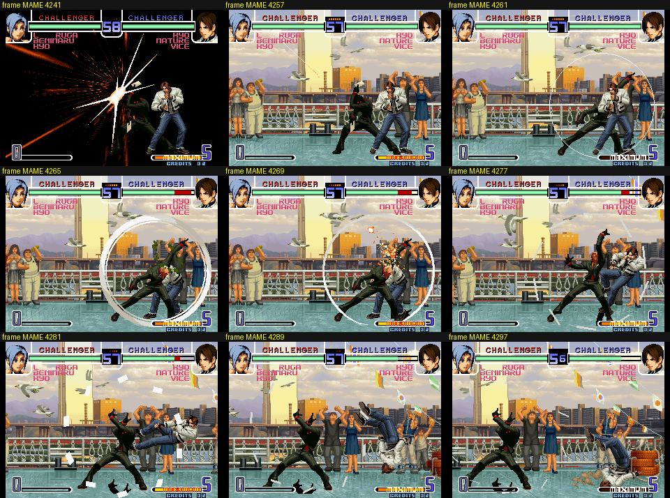

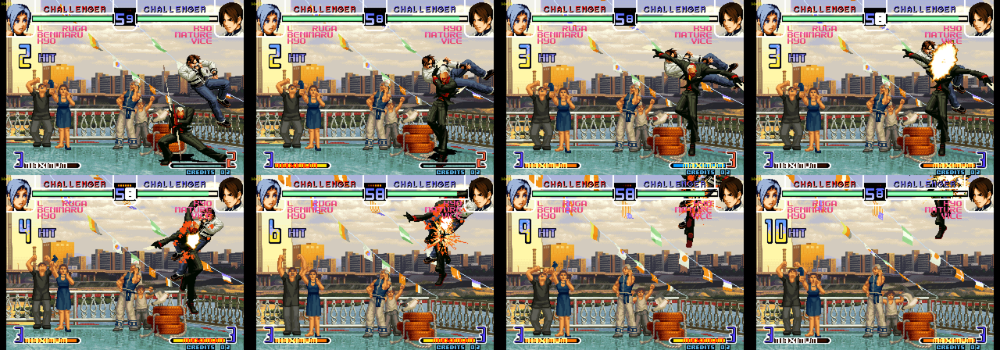

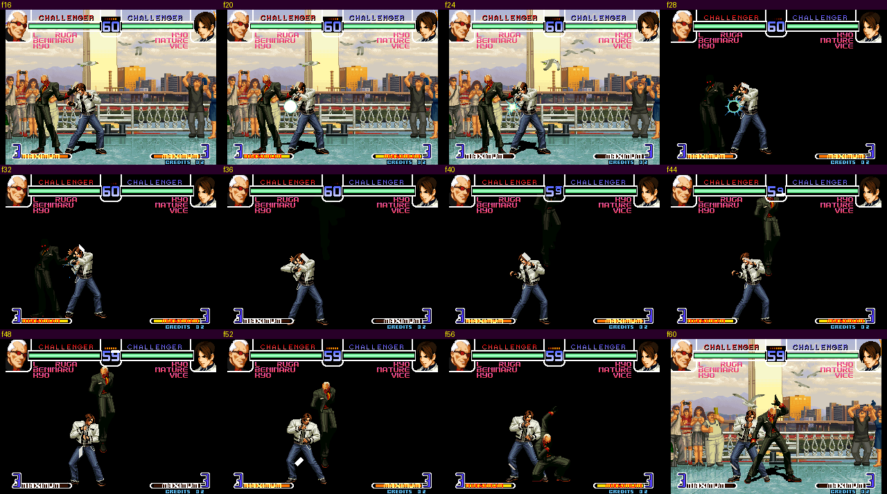

### 4.4 Chizuru Kagura

- **How to select:** cursor on **Mai** + **Start**.
- **Sprites and animations:** her 762 sprites, animations, boxes and physics, with KOF 2002 damage.
- **Specials:** Tamayura (a shield that reflects projectiles), Tenjin, Shinsoku + Tenzui and Choumon, with **her double**.
- **Supers:** DM *Reigi no Ishizue* and *Sanrai no Fujin*, their SUPER MAX versions and the HIDDEN *Sanjingi no San*. The Sanrai was measured frame by frame against the original.
- **Sound and portraits:** her voices, selectable in the voice utility, and her portraits.
- **Status:** phases 1-5 done, under review.

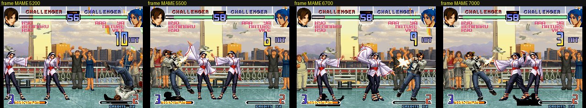

### 4.5 Rock Howard

- **How to select:** cursor on **Joe** + **Start**.
- **Made with the generic importer:** no custom code, everything comes from his data sheet.
- **Specials:** Reppuu Ken, Double Reppuu Ken, Hard Edge, Rising Tackle, Shinkuu Nage…
- **Supers:** DM *Raging Storm* and *Shine Knuckle*, their MAX versions and the HIDDEN *Deadly Rave* with its button chain.
- **Sound:** 103 situations with his own voices.
- **Status:** phases 1-5 done, under review.

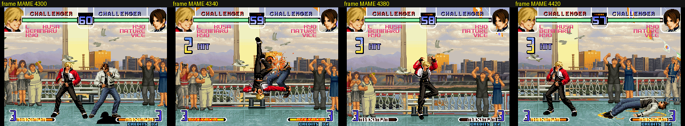

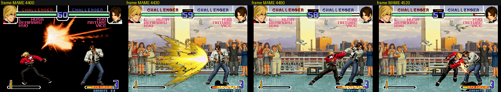

### 4.6 Violent Ken (coming soon)

- He comes from **SVC Chaos**, where his sprites come from.
- He will be selected with **Start on Ryo**. He has already been measured and planned; his supers will be the SVC ones.

### 4.7 How a character is brought in (8 phases)

1. **Measure:** sprites, colors, free space and questions for the player.
2. **Skeleton and normals:** identity, selection, basic states, normals, throws and physics.
3. **Specials.**
4. **Supers.**
5. **Voices and sounds.**
6. **Portraits and colors.**
7. **Polish:** automated tests in MAME and player tests in FBNeo.
8. **Credits** to the original authors and move to the stable version.

Each phase has a checkpoint: the player tests it and gives the OK before moving on.

---

## 5. What does not change from the original game

- The 41 original characters, their moves and their balance.
- The game modes, the music and the stages.
- FBNeo / Fightcade compatibility: both players need the same cartridge (same CRC).

---

## 6. New mechanics

### 6.1 PRACTICE mode with on-screen data (done)

The practice menu has a new page, **DISPLAY**, in the style of the *Dragon Ball FighterZ* training mode. Each option can be turned on or off:

- **HITBOX:** hurtboxes and hitboxes.
- **INPUT HISTORY** and **INPUT DISPLAY:** history and pressed buttons, with arrows in numpad notation.
- **DAMAGE, COMBO DAMAGE, MAX COMBO DAMAGE.**
- **STUN TIME:** frames the opponent remains stunned.
- **ATTACK START-UP, FRAME ADVANTAGE, INVINCIBILITY.**

Everything is inside the cartridge, so it works the same in FBNeo and on Fightcade.

| | |
|---|---|
| 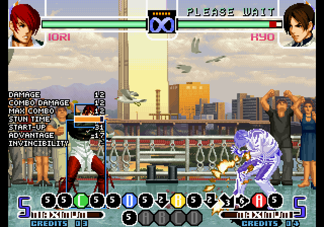 | 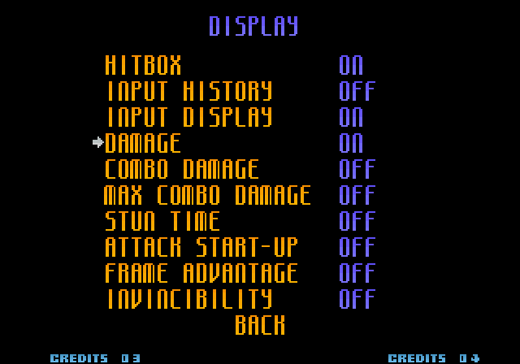 |

### 6.2 DRIVE (secondary goal, on a separate branch)

Our own design, inspired by Street Fighter 6 and KOF XIII. **It will not enter the stable version** until its BETA.

| Mechanic | What it does |
|---|---|
| **DRIVE resource** | 3 stocks per round, no regeneration |
| **Drive Rush** | After a normal that connects, forward-forward: a fast dash to link normals, throws, specials and DMs. Costs 1 stock. Each character has a type (**RUSH**, **TECHNICAL** or **POWER**) with its own speed, distance and advantage |
| **Drive Counter** | Hitting the opponent during their Drive Rush: more hitstun and the text "DRIVE COUNTER" |
| **Scaling** | Each Drive Rush in a combo reduces damage (85 % by default) |
| **Drive EX** | A special done with **A+C** or **B+D** comes out in its EX version: its own damage, advantage, invincibility, reaction, effects and palette. Costs 1 stock |

| | |
|---|---|
| 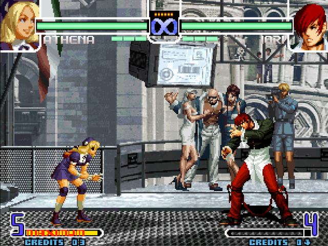 | |

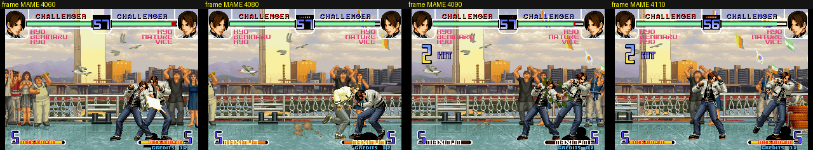

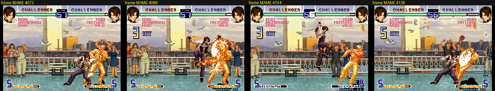

---

## 7. Editing tools

A **single editor** in the browser (local, no internet needed) brings together:

- **Animations** of any new character: sprites, timings, sounds per step, movement and the opponent's pose during throws, with a quick preview and a preview in the real game (MAME).
- **Effects:** any of the game's effects, your own effects from a PNG, and hand-picked PalMod-style colors with size, rotation and mirroring.
- **Drive EX:** all the properties from §6.2, montages of animation pieces, and exporting a move to a file to share it.
- **DRIVE values.**

There are also utilities for **voices** (choose, for each situation, between the voices of the source game, those of KOF 2002 or your own WAV files), for **received throws and colors**, and for **portraits and names** (select, life bar and victory).

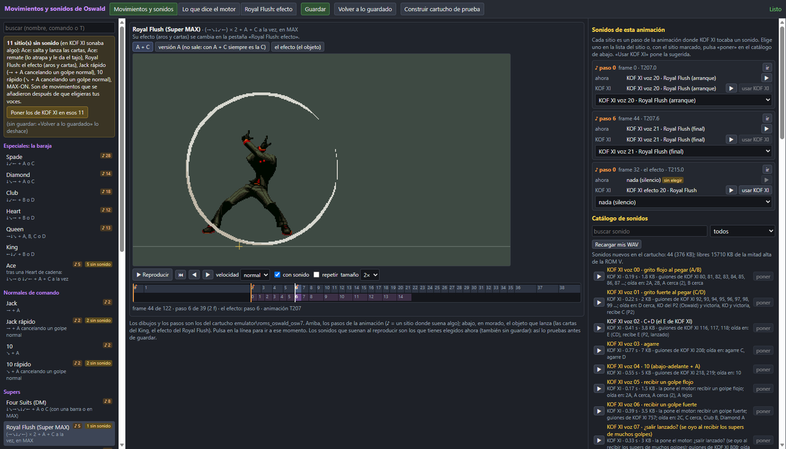

**Future plan:** release the Drive EX editor so the community can design moves. We will review the files (balance, space, that they don't break anything), integrate them into the ROM and credit each author.

---

## 9. Distribution, credits and legal

- **This repository will never contain** ROMs, BIOS, game files from SNK or other companies, or emulators with that data.
- How the playable versions will be released is **still to be decided**. Most likely as patches applied to the player's original romsets, together with the driver for FBNeo / Fightcade.
- Full credits to the authors will be included in the released version.
- *The King of Fighters*, its characters and its graphics are the property of **SNK**. This is a non-profit fan project.
