# THE KING OF FIGHTERS 2002 ULTIMATE

**Español** | [English](README.en.md)

Romhack de **The King of Fighters 2002 Plus** (Neo Geo). Añade **personajes nuevos sacados de otros juegos de lucha** (KOF 2001, 2003, XI, SVC Chaos y KOF 2002 UM) sin quitar a ninguno de los 41 originales, un **modo de práctica con datos en pantalla** y, más adelante, un sistema de mecánicas nuevas llamado **DRIVE / DRIVE EX**. Está pensado para jugar **en línea por Fightcade**.

> **Este repositorio solo recoge la descripción del proyecto, su hoja de ruta y el avance en imágenes.**
> Aquí no hay ROM, BIOS, código, herramientas ni emuladores. Para jugar hará falta tener los juegos originales de forma legal; el formato de distribución está por decidir (§9).

*Estado al 7 de noviembre de 2026.*

---

## Roster actual: personajes nuevos

| 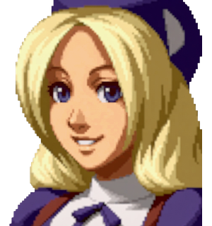 | 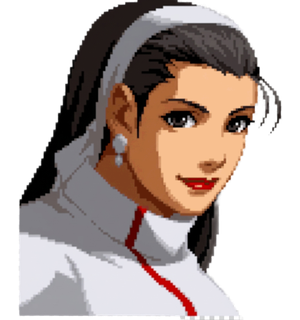 | 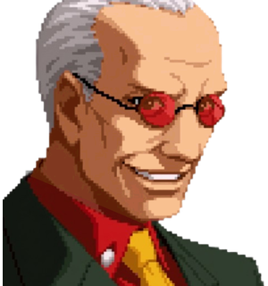 | 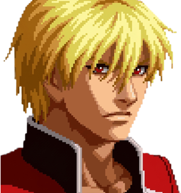 |
|:---:|:---:|:---:|:---:|
| **Hinako Shijou** | **Chizuru Kagura** | **Oswald** | **Rock Howard** |
| KOF 2002 UM | KOF 2003 | KOF XI | KOF 2003 |
| Start sobre Athena | Start sobre Mai | Start sobre Blue Mary | Start sobre Joe |

Además: **Orochi Iori** (SVC Chaos), que sale con el *Awakening* de Iori en pleno combate, y **Violent Ken** (SVC Chaos), en camino. Se suman a los 41 personajes originales de KOF 2002, que siguen todos.

---

## 1. Resumen

| Pregunta | Respuesta |
|---|---|
| ¿Qué es? | Un romhack de KOF 2002 Plus (`kf2k2pls`) sobre un **cartucho ampliado propio** (`kf2k2hnk`), con más espacio para programa, gráficos y sonido |
| Objetivo principal | **Personajes nuevos** completos (normales, agarres, especiales, supers, voces y retratos) sin reemplazar a nadie |
| Objetivo secundario | **Mecánicas DRIVE** (Drive Rush, Drive Counter, Drive EX) con su **editor** |
| Dónde se juega | FBNeo y **Fightcade** (en línea), con un driver propio. Todo va dentro del cartucho: nada de scripts ni trucos del emulador |
| Qué NO es | No es un motor nuevo: es el motor de KOF 2002 con datos y rutinas añadidos |

---

## 2. Glosario

| Término | Significado |
|---|---|
| **KOF 2002 Plus** (`kf2k2pls`) | La versión de KOF 2002 de Neo Geo que sirve de base |
| **Cartucho ampliado** (`kf2k2hnk`) | Nuestro romset: programa de 9 MB, gráficos de 128 MB, sonido Z80 de 512 KB y voces de 32 MB, con su propio driver en FBNeo / Fightcade |
| **Identidad** | Número interno de gráficos de cada personaje nuevo. Usa la lógica de un original (el «donante») y añade la suya propia encima |
| **Línea de tiempo (T)** | La animación de una acción: pasos con dibujo, duración, cajas, sonidos y efectos |
| **Cajas** | Caja de cuerpo (donde te pegan) y caja de golpe (donde pegas), por fotograma |
| **DM / SUPER MAX / HIDDEN** | Super normal, su versión en modo MAX y el super oculto |
| **DRIVE / Drive EX** | Recurso nuevo (3 stocks por ronda) y versión mejorada de un especial que gasta 1 stock |

---

## 3. Cómo está construido

- **Ingeniería inversa del motor.** Se ha documentado el programa del 68000 (personajes, animaciones, cajas, golpes, paletas, sonidos, menús), siempre midiendo en MAME.
- **Varios juegos, el mismo motor.** KOF 2001, 2002, 2003, SVC Chaos y UM comparten estructuras, así que sus datos se **traducen** al formato de 2002. KOF XI se descifró aparte.
- **Importador de personajes.** Convierte los datos de un personaje (dibujos, animaciones, cajas, estados, sonidos) al cartucho con un **intérprete** en ensamblador 68000. El **daño** siempre es el de KOF 2002. Un **comparador** pone frame a frame el original junto al cartucho.
- **Nada original se pisa.** Lo nuevo vive en espacio libre del cartucho ampliado. Cada cambio se comprueba con una huella de los 41 originales (tiene que dar 41/41) y, sin ediciones, el cartucho debe salir idéntico (mismo CRC).
- **Pruebas automáticas en MAME.** Combates por script sin ventana, lectura de RAM, registro de sonidos y partidas al azar para buscar cuelgues.
- **Herramientas para editar sin programar.** Páginas locales en el navegador para animaciones, efectos, cajas, voces, colores (estilo **PalMod**), retratos y Drive EX. Lo que se edita entra en el siguiente build (§7).

---

## 4. Personajes nuevos

### 4.1 Hinako Shijou: oculta, completa

- **Cómo se elige:** cursor sobre **Athena** + **Start**.
- **Jugabilidad:** basada en **KOF 2002 UM**: normales, normales de comando, combos de cadena, agarres, especiales (Tsukidashi, Shiko Toumi, Gorin Tsuki, Harite…) y supers, con un **HIDDEN nuevo, *Daisyarin***.
- **Gráficos y sonido:** dibujos de KOF 2003, voces de KOF 2001, retratos de selección, barra de vida y victoria.
- **Extras:** supercancel en MAX.
- **Estado:** todos los pasos hechos. Falta su prueba final y la prueba en red.

| | |
|---|---|
| 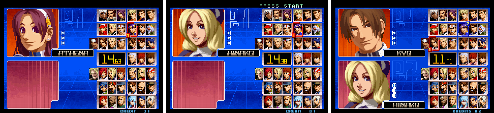 | 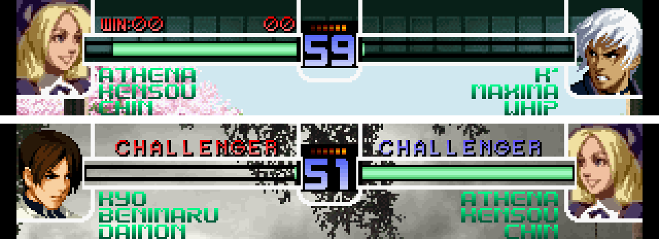 |
| 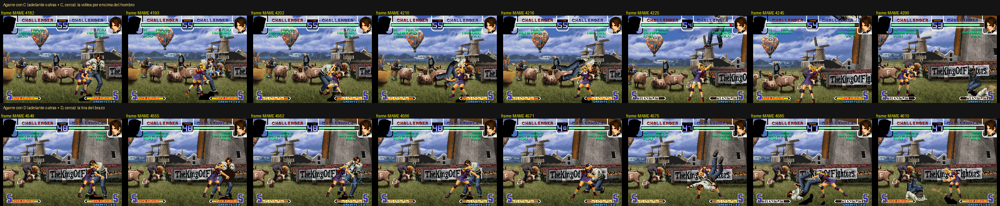 | 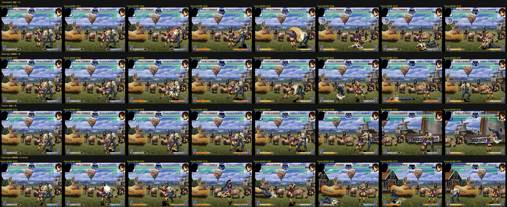 |
| 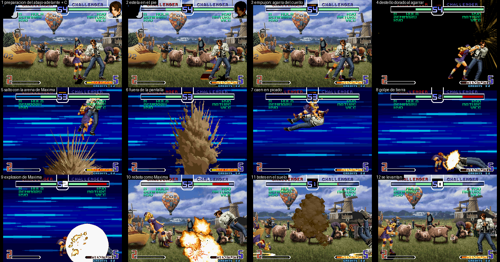 | 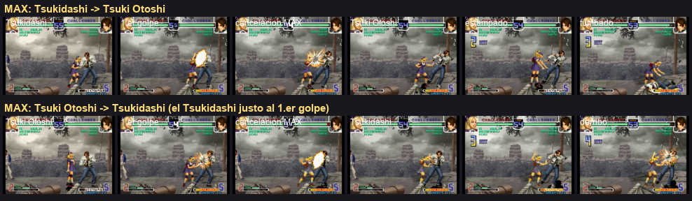 |
| 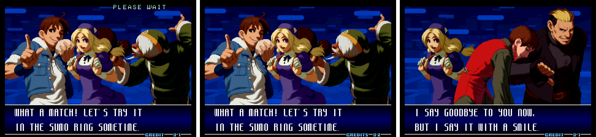 | 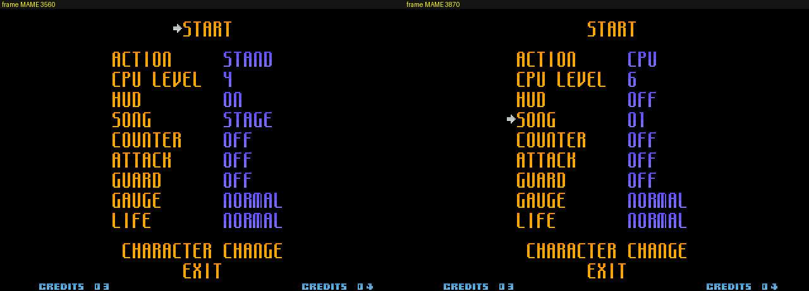 |

### 4.2 Orochi Iori (SVC Chaos): el despertar de Iori

- **Cómo sale:** Iori hace el **Awakening** (como Leona: ↑↓↑↓↑↓ + B+D). Cuesta media vida y dura hasta el final del asalto.
- **Gráficos:** los dibujos de SVC Chaos, con el cuerpo entero redibujado fotograma a fotograma y las cajas ajustadas solas a cada dibujo.
- **Hecho:** normales y física del SVC, agarres con una pose distinta para cada rival, especiales (Yami Barai, Oniyaki, Aoi Hana, Kototsuki You, Kuzukaze), supers (DM *Kin 1201 Shiki Ya Otome*, SUPER MAX *Oni Honou* y el HIDDEN **EXCEED** con el fondo rojo del Hidden de Iori), voces a elegir y retratos al despertar.
- **Estado:** en pulido y revisión.

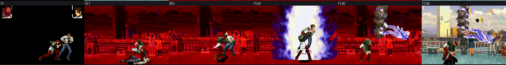

| | |
|---|---|
| 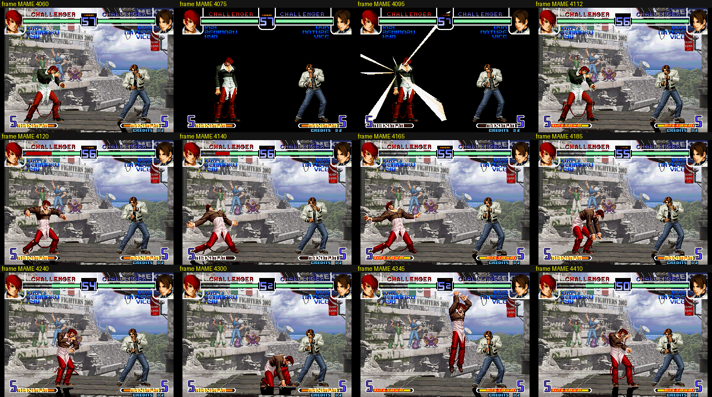 | 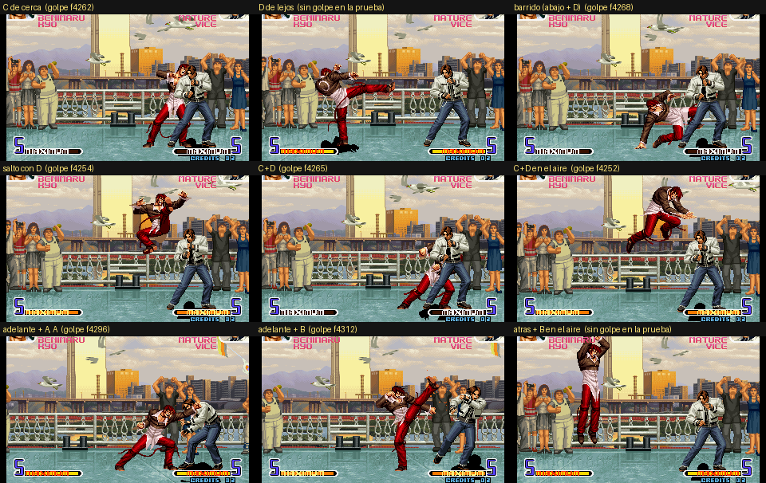 |
| 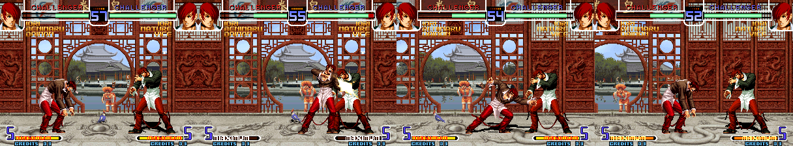 | |

### 4.3 Oswald (KOF XI)

- **Cómo se elige:** cursor sobre **Blue Mary** + **Start**.
- **Gráficos y sonido:** sus 828 dibujos de KOF XI, idénticos al original, y sus 59 voces y efectos.
- **Jugabilidad:** su **baraja** (Spade, Diamond, Club, Heart, Queen, King…) con la cadena y el **Ace**; normales, físicas y agarres de KOF XI; búfer de comandos como el de KOF XI.
- **Supers:** **Four Suits** (DM), **Royal Flush** (DM y SUPER MAX, con su animación y sus cartas) y **Joker** (HIDDEN, con fondo negro). El **King** funciona como contraataque.
- **Estado:** completo, en revisión.

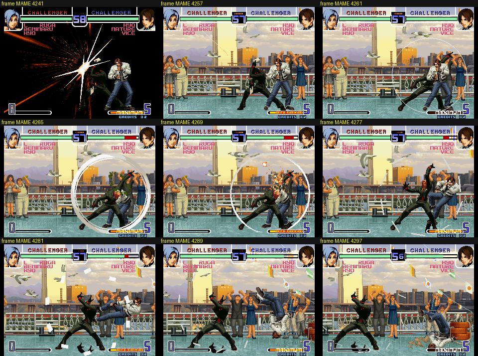

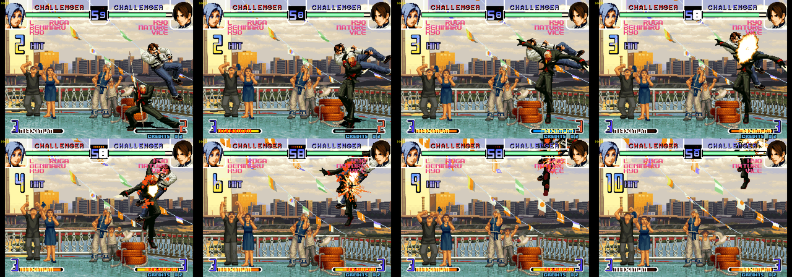

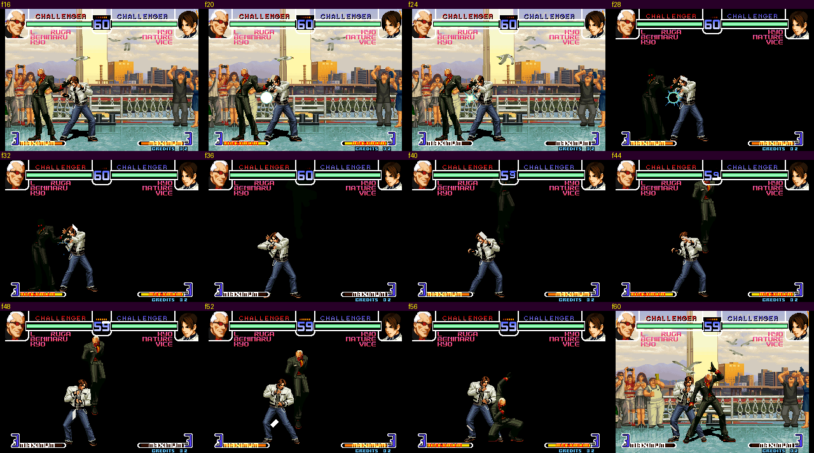

### 4.4 Chizuru Kagura

- **Cómo se elige:** cursor sobre **Mai** + **Start**.
- **Dibujos y animaciones:** sus 762 dibujos, animaciones, cajas y física, con el daño de KOF 2002.
- **Especiales:** Tamayura (escudo que devuelve proyectiles), Tenjin, Shinsoku + Tenzui y Choumon, con **su doble**.
- **Supers:** DM *Reigi no Ishizue* y *Sanrai no Fujin*, sus SUPER MAX y el HIDDEN *Sanjingi no San*. El Sanrai se midió frame a frame contra el original.
- **Sonido y retratos:** sus voces, a elegir en la utilidad de voces, y sus retratos.
- **Estado:** fases 1-5 hechas, en revisión.

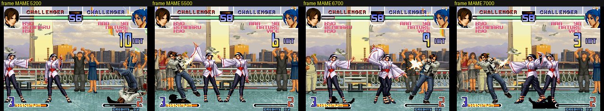

### 4.5 Rock Howard

- **Cómo se elige:** cursor sobre **Joe** + **Start**.
- **Hecho con el importador genérico:** sin código propio, todo sale de su ficha.
- **Especiales:** Reppuu Ken, Double Reppuu Ken, Hard Edge, Rising Tackle, Shinkuu Nage…
- **Supers:** DM *Raging Storm* y *Shine Knuckle*, sus versiones MAX y el HIDDEN *Deadly Rave* con su cadena de botones.
- **Sonido:** 103 situaciones con sus propias voces.
- **Estado:** fases 1-5 hechas, en revisión.

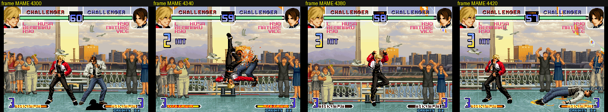

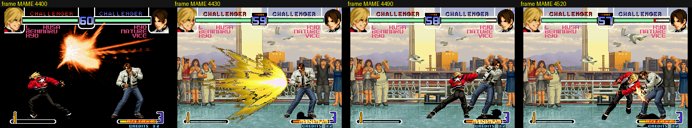

### 4.6 Violent Ken (en camino)

- Sale de **SVC Chaos**, de donde vienen sus dibujos.
- Se elegirá con **Start sobre Ryo**. Ya está medido y planificado; sus supers serán los del SVC.

### 4.7 Cómo se trae un personaje (8 fases)

1. **Medir:** dibujos, colores, espacio libre y preguntas al jugador.
2. **Esqueleto y normales:** identidad, selección, estados básicos, normales, agarres y física.
3. **Especiales.**
4. **Supers.**
5. **Voces y sonidos.**
6. **Retratos y colores.**
7. **Pulido:** pruebas automáticas en MAME y pruebas del jugador en FBNeo.
8. **Créditos** a los autores originales y paso a la versión estable.

En cada fase hay un punto de control: el jugador lo prueba y da el OK antes de seguir.

---

## 5. Lo que no cambia del juego original

- Los 41 personajes originales, sus movimientos y su equilibrio.
- Los modos de juego, la música y los escenarios.
- La compatibilidad con FBNeo / Fightcade: los dos jugadores necesitan el mismo cartucho (mismo CRC).

---

## 6. Mecánicas nuevas

### 6.1 Modo PRACTICE con datos en pantalla (hecho)

En el menú de práctica hay una página nueva, **DISPLAY**, al estilo del modo de entrenamiento de *Dragon Ball FighterZ*. Cada opción se puede encender o apagar:

- **HITBOX:** cajas de cuerpo y de golpe.
- **INPUT HISTORY** e **INPUT DISPLAY:** historial y botones pulsados, con flechas en notación numérica.
- **DAMAGE, COMBO DAMAGE, MAX COMBO DAMAGE.**
- **STUN TIME:** frames que el rival sigue aturdido.
- **ATTACK START-UP, FRAME ADVANTAGE, INVINCIBILITY.**

Va todo dentro del cartucho, así que funciona igual en FBNeo y en Fightcade.

| | |
|---|---|
| 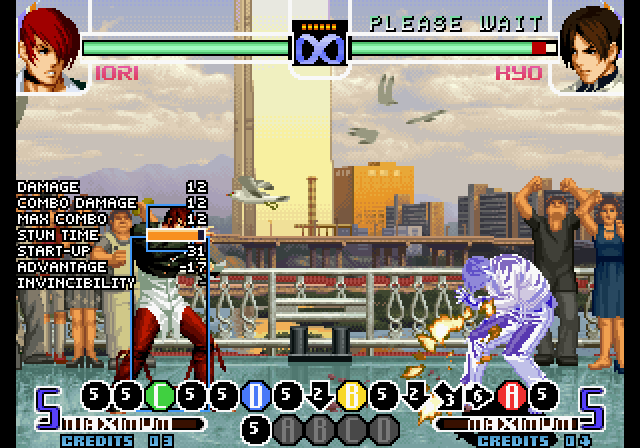 | 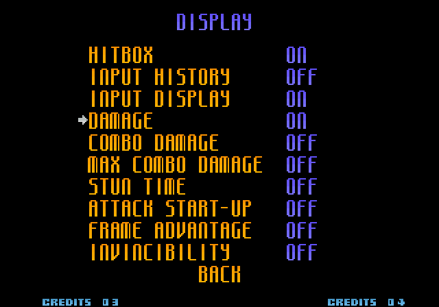 |

### 6.2 DRIVE (objetivo secundario, en una rama aparte)

Diseño propio, inspirado en Street Fighter 6 y KOF XIII. **No entra en la versión estable** hasta su BETA (§8).

| Mecánica | Qué hace |
|---|---|
| **Recurso DRIVE** | 3 stocks por ronda, sin regeneración |
| **Drive Rush** | Tras un normal que conecta, adelante-adelante: carrera rápida para enlazar normales, agarres, especiales y DM. Cuesta 1 stock. Cada personaje tiene un tipo (**RUSH**, **TÉCNICO** o **POTENCIA**) con su velocidad, recorrido y ventaja |
| **Drive Counter** | Golpear al rival durante su Drive Rush: más aturdimiento y el texto «DRIVE COUNTER» |
| **Escalado** | Cada Drive Rush en un combo reduce el daño (85 % por defecto) |
| **Drive EX** | Un especial con **A+C** o **B+D** sale en su versión EX: daño, ventaja, invulnerabilidad, reacción, efectos y paleta propios. Cuesta 1 stock |

| | |
|---|---|
| 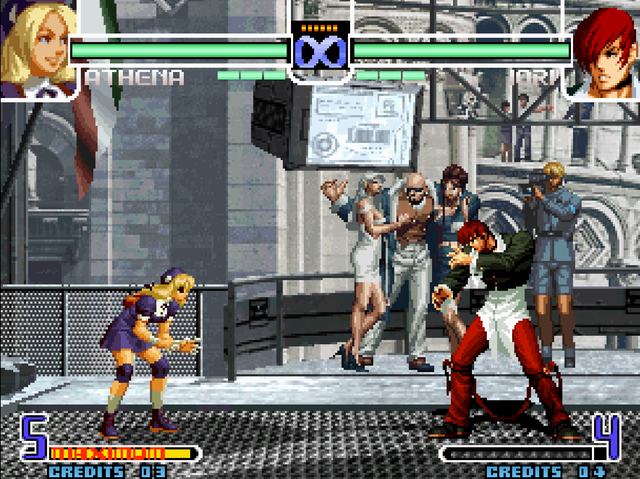 | |

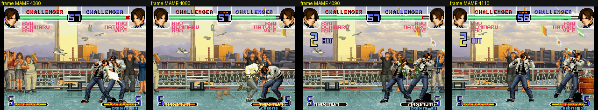

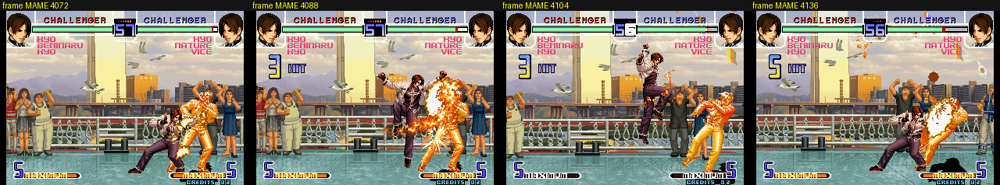

---

## 7. Herramientas de edición

Un **editor único** en el navegador (local, sin internet) reúne:

- **Animaciones** de cualquier personaje nuevo: dibujos, tiempos, sonidos por paso, desplazamientos y la pose del rival en los agarres, con vista rápida y vista en el juego real (MAME).
- **Efectos:** cualquiera de los efectos del juego, efectos propios a partir de un PNG, y colores a mano estilo PalMod con tamaño, giro y espejo.
- **Drive EX:** todas las propiedades del §6.2, montajes de trozos de animación y exportar un movimiento a un archivo para compartirlo.
- **Valores del DRIVE.**

Aparte hay utilidades de **voces** (elegir en cada situación entre las voces del juego de origen, las de KOF 2002 o archivos WAV propios), de **agarres recibidos y colores**, y de **retratos y nombres** (selección, barra de vida y victoria).

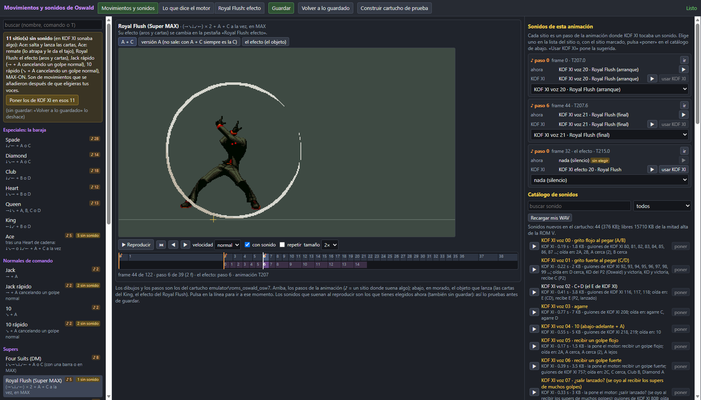

**Plan a futuro:** publicar el editor de Drive EX para que la comunidad diseñe movimientos. Revisaremos los archivos (equilibrio, espacio, que no rompan nada), los integraremos en la ROM y daremos crédito a cada autor.

---

## 9. Distribución, créditos y aspectos legales

- **Este repositorio nunca contendrá** ROM, BIOS, archivos de juegos de SNK u otras compañías ni emuladores con esos datos.
- La forma de publicar las versiones jugables está **por decidir**. Probablemente serán parches que se aplican sobre los romsets originales del jugador, junto con el driver para FBNeo / Fightcade.
- Los créditos completos a los autores irán en la versión publicada.
- *The King of Fighters*, sus personajes y sus gráficos son propiedad de **SNK**. Es un proyecto de fans, sin ánimo de lucro.
