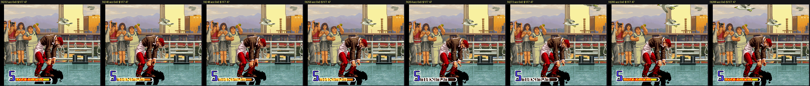
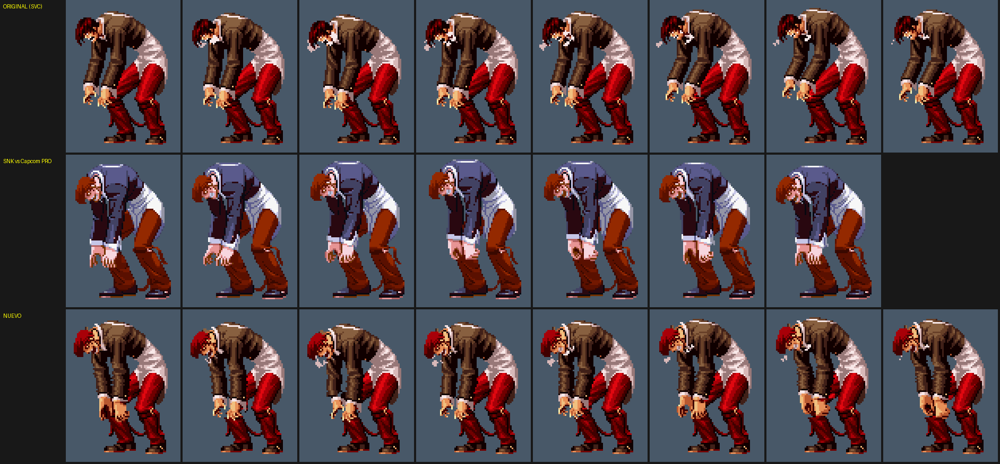

# KOF 2002 Ultimate

Romhack de **The King of Fighters 2002 Plus** (Neo Geo) con personajes nuevos, pensado para jugar **en línea por Fightcade**.

Este repositorio solo recoge la **descripción del proyecto y el avance en imágenes**. El código, las herramientas, las ROM y los emuladores no están aquí.

## Qué es

- Un **cartucho ampliado propio** (`kf2k2hnk`), con más espacio para gráficos, sonido y código que el original, y su propio driver en FBNeo / Fightcade.
- Los 40 personajes originales **no se tocan**: los nuevos se añaden sin reemplazar a nadie.
- Se prueba en MAME, FBNeo y en el emulador de Fightcade.

## Personajes nuevos

### Hinako Shijou (oculta)

- En la selección: cursor sobre **Athena** + **Start**.
- Jugabilidad basada en la versión de **KOF 2002 Unlimited Match**: normales, normales de comando, agarres, especiales y supers, incluido un HSDM nuevo (*Daisyarin*).
- Gráficos de KOF 2003, voces de KOF 2001, retratos de selección, de la barra de vida y de victoria con sus frases.
- Menú de práctica: CPU, nivel de CPU, HUD y música.

| | |
|---|---|
|  |  |
|  |  |
|  |  |
|  |  |

### Orochi Iori (Awakening de Iori)

- Sale de **SVC Chaos**: Iori se transforma con un **Awakening**, como Leona (↑ ↓ rápido + B+D), hasta el final del round.
- Hecho: la transformación, sus golpes normales y de comando del SVC, su física y su defensa.
- Su animación quieta está rehecha con la pose de la versión **PRO**, con el dibujo del SVC y la cabeza del PRO.

| | |
|---|---|
|  |  |
|  |  |

## Hoja de ruta

| Paso | Estado |
|---|---|
| Hinako: pasos 1-9 (estados, normales, agarres, especiales, supers, sonido, retratos, práctica) | Hecho, en pruebas |
| Cartucho ampliado + driver propio en Fightcade (M0-M4) | Hecho; falta la prueba en red con un amigo |
| Orochi Iori O1-O2 (transformación, normales) | Hecho, en pruebas |
| Orochi Iori O3: agarres | Siguiente |
| Orochi Iori O4-O9: especiales, supers, sonido, retratos, pulido | Pendiente |
| Utilidad para editar animaciones y retratos sin programar | Hecha; siguiente: visor de cabezas para Orochi Iori |
